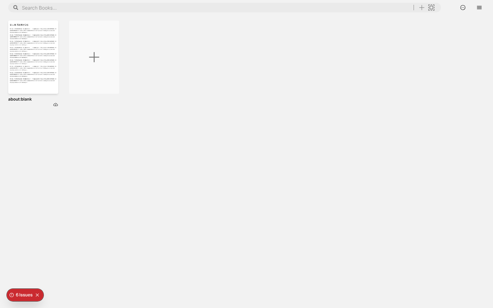
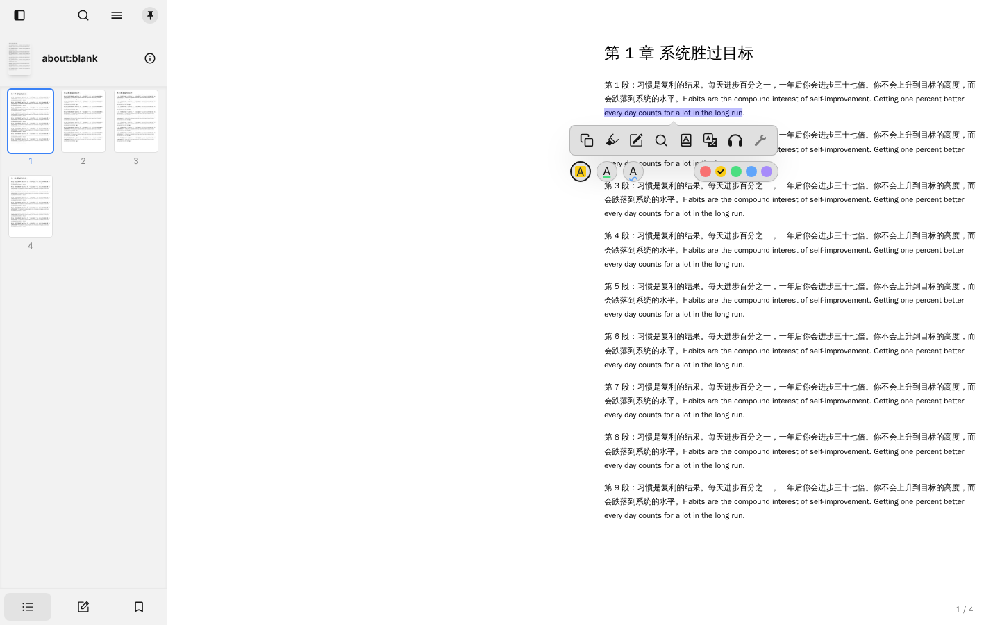
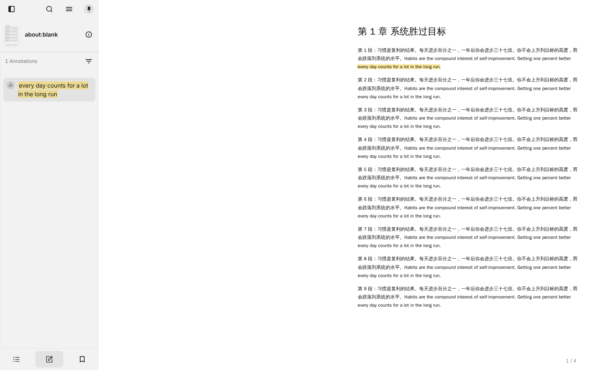

# M0 检查报告：Readest 现有功能

| 项目 | 内容 |
|---|---|
| 日期 | 2026-10-21 |
| 代码版本 | upstream `b00b9f4`（2026-10-20） |
| 运行方式 | 网页开发模式（`pnpm dev-web`），Chromium 浏览器 |
| 测试文件 | 自己生成的 4 页中英文混排 PDF（文字版） |

## 1. 运行步骤

```bash
# 在仓库根目录
git submodule update --init --depth 1 \
  packages/foliate-js packages/simplecc-wasm packages/js-mdict packages/qcms \
  apps/readest-app/src-tauri/plugins/tauri-plugin-turso \
  apps/readest-app/src-tauri/plugins/tauri-plugin-webview-upgrade

cd apps/readest-app
pnpm install
pnpm setup-vendors
pnpm dev-web          # 打开 http://localhost:3000
# 桌面版：pnpm tauri dev（需要 Rust）
```

注意：如果没有初始化 `tauri-plugin-turso` 子模块，网页版也会报 500 错误（`Can't resolve 'tauri-plugin-turso'`）。

## 2. 测试结果

| 功能 | 结果 | 说明 |
|---|---|---|
| 导入 PDF | ✅ 通过 | 书库 → Import Books → From Local File |
| 显示 PDF | ✅ 通过 | 中文、英文都显示正常；左栏有页面缩略图 |
| 选中文字 | ✅ 通过 | 弹出工具条：复制、高亮、批注、搜索、词典、翻译、朗读 |
| 高亮 | ✅ 通过 | 5 种颜色，3 种样式（背景、下划线、波浪线） |
| 笔记列表 | ✅ 通过 | 左栏"笔记"标签页显示高亮，数量正确 |
| AI 对话 | ⏸ 未测试 | 默认关闭；需要 API Key。代码中只支持 Ollama、OpenRouter、AI Gateway |
| Notion 同步 | ⏸ 未测试 | 需要 Notion Token。设置入口在 Settings → Integrations |
| Markdown 导出 | ⏸ 未测试 | 代码中有 `ExportMarkdownDialog` |
| 桌面版（Tauri） | ⏸ 未测试 | 测试环境没有图形界面 |

截图：

| 书库 | 选中文字 | 高亮和笔记列表 |
|---|---|---|
|  |  |  |

## 3. 发现的问题

1. **PDF 默认双页显示，第 1 页单独显示在右边。** 左半边是空白，浪费空间。改成三栏布局后，中栏更窄，应该默认改成单页、连续滚动。
2. **书名显示为 `about:blank`。** 原因是测试 PDF 的元数据中没有标题。应该在没有标题时使用文件名。
3. **左栏已经是"目录 / 笔记 / 书签"三个标签页。** 这符合"左栏笔记"的需求，可以保留。AI 需要移到右边单独的一栏。

## 4. 下一步（M1）

1. 加入 Claude 直连：在 `src/services/ai/providers/` 增加 Anthropic provider（使用 `@ai-sdk/anthropic`）。
2. 三栏布局：右边增加固定的 AI 栏，可以折叠、可以拖动宽度。
3. 改 PDF 默认显示方式为单页滚动。
4. 用你的 Claude API Key 和 Notion Token 测试 AI 对话、Notion 同步和 Markdown 导出。
