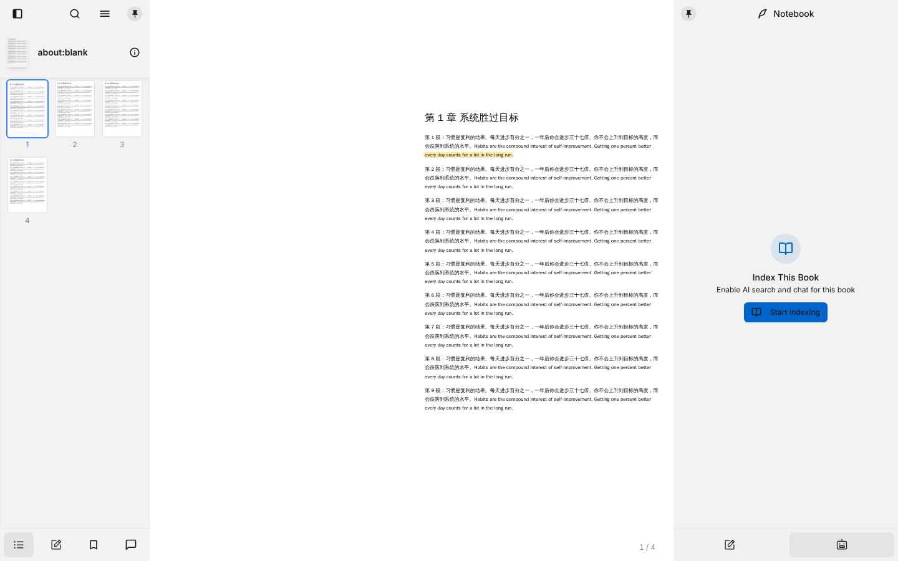
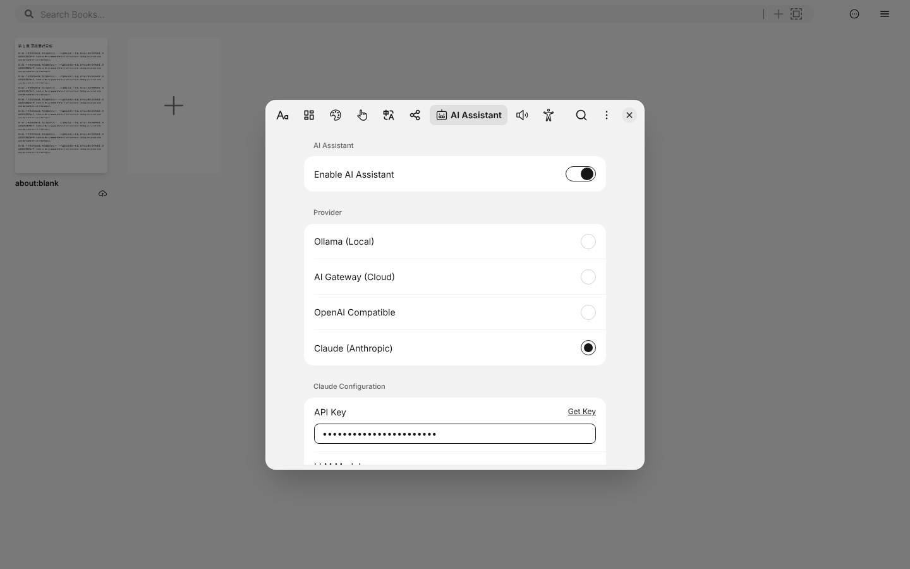

# M1 报告：接入 Claude 和三栏布局

| 项目 | 内容 |
|---|---|
| 日期 | 2026-10-22 |
| 分支 | `claude/github-pdf-reader-research-mb7ei0` |
| 运行方式 | 网页开发模式（`pnpm dev-web`），Chromium 浏览器 |

## 1. 结果

| 目标 | 结果 |
|---|---|
| 接入 Claude | ✅ 设置里新增 "Claude (Anthropic)"，可以选 Opus 5.5、Sonnet 5.5、Haiku 5.5 |
| 三栏布局 | ✅ Readest 原本就支持，不用改代码。固定左栏和右栏后，重新打开书会保持这个布局 |
| 双页模式 | ✅ 保留，没有改 |

## 2. 提交

| 提交 | 内容 |
|---|---|
| `aaada13` | 新增 Claude 接口。Claude 没有向量化（embedding）接口，所以书籍索引改为只用关键词检索 |
| `8704276` | 正式打包的版本也显示 AI 设置页（Readest 原来只在开发模式下显示） |
| `f8811ab` | 固定 `@ai-sdk/anthropic` 版本，保证 Readest 对旧版 iOS Safari 的补丁继续生效 |
| `f2147c0` | 修复 `@assistant-ui/react` 的一个错误：书籍建好索引后，打开 AI 标签页会使整个阅读页崩溃 |
| `38e5e2d` | 删除测试文件里一个没用到的 import |

## 3. 使用方法

1. 打开设置 → **AI Assistant**，打开 **Enable AI Assistant**。
2. Provider 选 **Claude (Anthropic)**。
3. 填入 API Key（在 [console.anthropic.com](https://console.anthropic.com/settings/keys) 获取），选择模型，点 **Test Connection** 确认连接成功。
4. 打开一本书：
   - 点左上角的图标打开左栏，点图钉固定。左栏底部的第 2 个标签是标注和笔记。
   - 点右上角的羽毛笔图标打开右栏（笔记本），点左上角的图钉固定，再点底部的机器人图标切换到 AI。
5. 第一次在一本书里使用 AI 时，点 **Start Indexing** 建立索引，然后就可以提问了。

## 4. 检查记录

| 检查 | 结果 |
|---|---|
| 新增单元测试 | 3 个测试文件都先在旧代码上确认失败，再确认改动后通过 |
| `src/__tests__/ai` 全部测试 | 63 个测试通过 |
| `pnpm lint`（tsc + biome） | 通过 |
| 完整单元测试 `pnpm test` | 有 8 个文件、37 个测试失败（文档加载、Yomitan 词典、小说导入等）。在没有任何改动的原始代码上同样失败，和本次改动无关 |
| 网页版：Claude 设置 | 用无效的密钥点 Test Connection，请求发到了 `api.anthropic.com/v1/models`，返回 401，界面显示"密钥无效" |
| 网页版：建立索引 | 没有向量化也能建好索引 |
| 网页版：AI 对话 | 问题发到了 `api.anthropic.com/v1/messages`，返回 401（因为密钥无效） |

## 5. 没有测试的内容

- **用有效的 API Key 真正对话。** 这里没有可用的密钥，需要你在自己的电脑上试。
- **桌面版（Tauri）。** 这里没有图形界面。
- **Nix 打包和 `pnpm build-web`。** 新增了依赖，`nix/package.nix` 里的依赖哈希没有更新。只用 Tauri 打包的话不影响。

## 6. 发现的问题（还没修）

1. **密钥无效时，AI 的回答是空白的，没有提示原因。** 这是 Readest 原有的行为。建议在对话里显示错误信息。
2. **中栏较窄时，双页模式下的字会很小。** 如果觉得字太小，可以在视图菜单里切换成单页，或关闭"封面单独显示"。
3. **推送时跳过了 Readest 自带的推送前测试**（`--no-verify`），因为上面那 37 个和本次改动无关的测试会让它失败。
