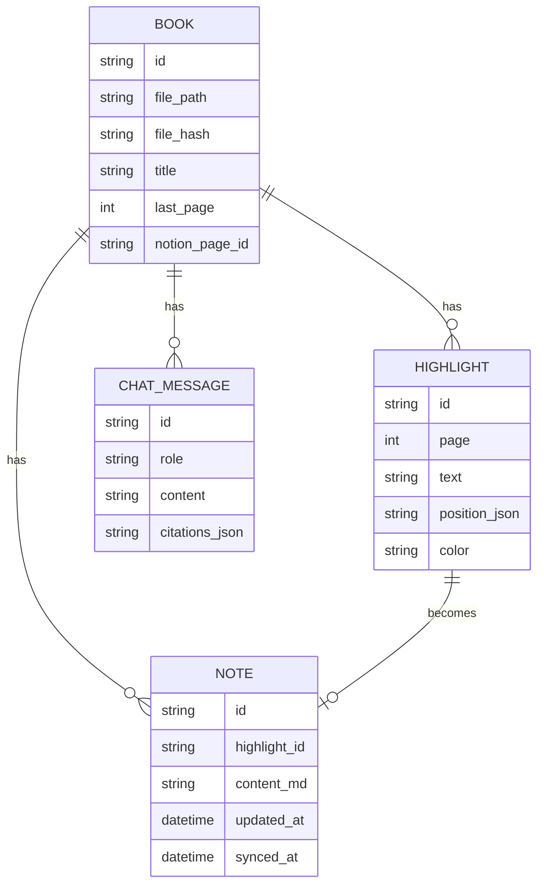

# AI Reader 需求文档（PRD）

| 项目 | 内容 |
|---|---|
| 版本 | v0.2（草稿）：改为基于 Readest 二次开发 |
| 日期 | 2026-10-20 |
| 状态 | 待确认 |
| 负责人 | ryanthp2001 |

---

## 1. 背景

读书时，我需要三样东西同时在手边：书、笔记、一个能帮我理解内容的助手。现有工具都只解决了一部分：

| 工具 | 缺什么 |
|---|---|
| Zotero + 插件 | 三个功能分散在不同插件里，笔记不能在 Notion 中直接整理 |
| Readest / Koodo Reader | PDF 支持弱，AI 功能少，不能同步 Notion |
| Readwise Reader | 付费，不开源，数据在别人的服务器上 |

**目标：** 做一个桌面阅读器，用一个窗口完成"读 → 划线 → 问 AI → 记笔记 → 存到 Notion"。

## 2. 目标用户

- **第一阶段：** 只有我自己。不做登录、付费、多用户。
- **以后：** 可能开放给别人用。所以代码结构要留出扩展空间，例如：不把 API Key 写死在代码里，不假设只有一个用户的目录结构。

## 3. 产品目标和衡量标准

| 目标 | 衡量标准 |
|---|---|
| 读书时不用切换窗口 | 划线、提问、记笔记都在一个窗口内完成 |
| AI 回答可信 | 每个回答都标出页码，点击能跳回原文 |
| 笔记不会丢 | 笔记存在本地；同步到 Notion；能导出 Markdown |
| 我自己真的会用 | 连续两周用它读完至少一本书 |

## 4. 范围

### 4.1 第一版（MVP）要做

1. 打开本地 PDF 并流畅阅读
2. 划线、高亮（多种颜色）、批注
3. 选中文字后直接问 AI
4. AI 回答带页码引用，点击能跳转
5. 左栏写笔记，笔记和原文双向跳转
6. 笔记同步到 Notion
7. 笔记导出为 Markdown

### 4.2 第一版不做

| 功能 | 原因 | 计划 |
|---|---|---|
| EPUB 等其他格式 | 先把 PDF 做好 | v0.3 |
| 间隔复习 | 需要先积累笔记数据 | v0.2 |
| 跨书提问 | 需要向量检索，工作量大 | v0.3 |
| 扫描版 PDF 的 OCR | 依赖额外工具 | v0.3 |
| 朗读、对照翻译 | 不是核心需求 | 待定 |
| 多端同步、手机版 | 先只做桌面 | 待定 |
| 账号、登录、付费 | 现在只有我自己用 | 开放时再做 |

## 5. 界面布局

```
┌──────────────┬──────────────────────────────┬──────────────┐
│  左栏：笔记   │        中栏：PDF 阅读         │ 右栏：AI 助手 │
│              │                              │              │
│ • 按页码排序  │   [选中文字后弹出工具条]       │  对话记录     │
│ • 每条笔记显示│   高亮 | 批注 | 问AI | 解释    │  [p.45] 引用  │
│   原文引用    │                              │              │
│ • 同步状态    │                              │  输入框       │
│ [同步Notion]  │   ◀ 第 45 / 320 页 ▶          │  [存为笔记]   │
└──────────────┴──────────────────────────────┴──────────────┘
```

- 左栏和右栏都可以折叠，也可以拖动改变宽度
- 顶部工具栏：打开文件、目录、搜索、缩放、设置

## 6. 用户故事和验收标准

### US-1 打开 PDF

> 作为读者，我想打开电脑上的 PDF，并从上次读到的地方继续读。

- [ ] 能通过菜单或拖拽打开 PDF
- [ ] 300 页的 PDF 在 3 秒内显示第一页
- [ ] 支持缩放、翻页、跳转到指定页、显示目录
- [ ] 支持在书中搜索文字
- [ ] 重新打开时自动回到上次的页码
- [ ] "最近打开"列表显示最近 10 本书

### US-2 划线和批注

> 作为读者，我想把重要的句子高亮，并在旁边写下想法。

- [ ] 选中文字后弹出工具条
- [ ] 至少 4 种高亮颜色，可以自己定义每种颜色的含义（例如：黄色 = 重点，红色 = 疑问）
- [ ] 可以给高亮添加批注
- [ ] 可以修改和删除高亮
- [ ] 关闭再打开后，高亮还在原来的位置
- [ ] 标注存在应用自己的数据库里，**不修改原 PDF 文件**

### US-3 选中文字问 AI

> 作为读者，我遇到看不懂的段落时，想直接让 AI 解释。

- [ ] 工具条上有快捷按钮："解释"、"翻译"、"举个例子"、"总结本页"
- [ ] 也可以在右栏自由提问
- [ ] AI 能看到：选中的文字、当前页的内容、书名和章节标题
- [ ] 回答以流式输出（边生成边显示）
- [ ] 同一本书的对话记录会保存，下次打开还在

### US-4 回答带引用

> 作为读者，我想知道 AI 的回答依据的是书里哪一段，这样我才能判断它说得对不对。

- [ ] 回答中引用原文的地方显示为 `[p.45]` 这样的标签
- [ ] 点击标签后，中栏跳到对应页并高亮被引用的文字
- [ ] AI 不能确定时，要说明"书中没有找到相关内容"，不能编造

### US-5 笔记

> 作为读者，我想把高亮、批注和 AI 的好回答整理成笔记。

- [ ] 每个高亮自动成为左栏的一条笔记（包含原文、页码、颜色、批注）
- [ ] AI 的回答可以一键"存为笔记"
- [ ] 可以添加不对应任何原文的自由笔记
- [ ] 点击笔记，中栏跳到原文；点击原文上的高亮，左栏定位到对应笔记
- [ ] 笔记支持 Markdown 格式
- [ ] 可以按页码、时间、颜色排序或筛选

### US-6 同步到 Notion

> 作为 Notion 用户，我想让读书笔记自动出现在我的 Notion 里。

- [ ] 在设置中填写 Notion Integration Token，并选择一个目标数据库
- [ ] 每本书在 Notion 中对应一个页面，笔记是页面里的内容块
- [ ] 支持手动同步，也支持开启自动同步
- [ ] 重复同步不会产生重复内容（只同步新增和修改的笔记）
- [ ] 断网时笔记照常保存，联网后再同步
- [ ] 同步失败时显示原因，例如"Token 无效"、"没有数据库权限"

### US-7 导出 Markdown

> 作为读者，我想把笔记导出成本地文件，作为备份或用于其他软件。

- [ ] 一键把一本书的全部笔记导出为一个 `.md` 文件
- [ ] 文件包含：书名、作者、每条笔记的原文引用、页码、批注
- [ ] 格式兼容 Obsidian 和 Logseq

## 7. 非功能需求

### 7.1 界面设计要求

界面美观、有设计感，是本项目的核心要求之一，不是锦上添花。

| 方面 | 要求 |
|---|---|
| 整体风格 | 简洁、安静，内容优先。参考 Readest、Apple Books、Readwise Reader |
| 排版 | 正文字体、字号、行距可以调整；中文默认使用适合长时间阅读的字体 |
| 配色 | 浅色、深色、护眼（米黄）三种主题；高亮颜色柔和，不刺眼 |
| 三栏 | 左右两栏可以折叠、可以拖动宽度；专注模式下只显示中栏 |
| 细节 | 统一的圆角、阴影和间距；工具条和面板展开时有简短的过渡动画 |
| AI 面板 | 回答排版清楚（标题、列表、代码、公式）；引用标签样式醒目但不突兀 |
| 验收方法 | 每个里程碑结束时截图对比；和 Readest 原版放在一起比较，不能变差 |

| 类别 | 要求 |
|---|---|
| 隐私 | 所有数据默认存在本地。只有用户主动使用时，内容才会发给 Claude API 或 Notion |
| 安全 | API Key 和 Notion Token 存在系统钥匙串（macOS Keychain / Windows 凭据管理器），不写进普通配置文件 |
| 性能 | 翻页不卡顿；500 页以内的 PDF 打开时间不超过 3 秒 |
| 稳定 | AI 或 Notion 请求失败时，不影响阅读和记笔记 |
| 平台 | 第一版支持 macOS 和 Windows |
| 费用 | 设置中显示本月 AI 用量的估算，避免意外产生高额费用 |

## 8. 技术方案

### 8.0 决定：基于 Readest 二次开发，不从零写

[Readest](https://github.com/readest/readest) 是一个开源电子书阅读器。它的界面设计成熟，并且已经实现了本需求的大部分功能。在它的基础上修改，界面效果更好，工期也更短。


**Readest 的现状（2026-10-20 检查了它最新的代码）：**

| 本文档的需求 | Readest 现状 | 要做的工作 |
|---|---|---|
| US-1 打开 PDF | ✅ 有（基于 PDF.js），也支持 EPUB 等格式 | 用真实的 PDF 测试分栏、公式等情况 |
| US-2 划线和批注 | ✅ 有，多种颜色，可以自定义 | 基本不用改 |
| US-3 选中文字问 AI | 🟡 有 AI 对话（RAG），默认关闭 | 在选中文字的工具条上加"解释 / 翻译 / 举例"按钮 |
| US-4 回答带引用 | 🟡 回答下方有"Sources from book"，可以点击 | 改成在正文里显示 `[p.45]`，点击跳转并高亮 |
| US-5 笔记 | ✅ 有，高亮列表按章节分组，可以跳转 | 加"把 AI 回答存为笔记" |
| US-6 同步到 Notion | ✅ 有 Notion 同步模块 | 测试并调整格式；确认不会重复同步 |
| US-7 导出 Markdown | ✅ 有 | 检查与 Obsidian / Logseq 的兼容性 |
| 三栏布局 | 🟡 左边是目录和笔记，AI 在笔记本面板里 | 改成固定的三栏：左笔记、中阅读、右 AI |
| Claude | 🟡 支持 Ollama、OpenRouter、AI Gateway（OpenRouter 可以使用 Claude） | 用 `@ai-sdk/anthropic` 加一个直连 Claude 的选项 |
| 跨平台 | ✅ macOS、Windows、Linux、手机、网页 | 不用改 |

**Readest 的技术栈：** Tauri 2 + Next.js + React + TypeScript + Tailwind CSS + DaisyUI。AI 部分用 Vercel AI SDK 和 assistant-ui。与本文档原定的技术方案一致。

**许可证注意事项：** Readest 使用 AGPL-3.0 许可证。
- 只给自己用：没有限制。
- 以后开放给别人用：修改后的完整源代码也必须以 AGPL-3.0 公开，包括通过网络提供服务的情况。所以不能把它做成闭源的商业产品。
- 修改时要保留原作者的版权声明。

**开发方式：**
1. 在 GitHub 上 fork Readest。
2. 尽量把修改集中在少数文件里，并定期合并上游的更新，这样能持续得到 Readest 的修复和新功能。
3. 通用的改进（例如 Claude 支持）可以提交 PR 给上游，减少以后需要自己维护的代码。

**备选方案：** 如果 Readest 的代码太大、改不动，可以换用更小的 [pdfgist](https://github.com/turinglambdaai/pdfgist)（Tauri 2 + PDF.js，AGPL-3.0）或 [ai-pdf-reader](https://github.com/adrirubio/ai-pdf-reader)（Electron + React，MIT）。它们的代码少，容易修改，但界面和功能都比 Readest 少很多。

### 8.0.1 原定技术方案（作为参考）

| 部分 | 选择 | 原因 |
|---|---|---|
| 桌面框架 | Tauri 2 | 安装包小（约 10 MB），比 Electron 省内存；可以访问本地文件和系统钥匙串 |
| 前端 | React + TypeScript | 生态成熟，PDF 和编辑器相关的库多 |
| PDF 显示和标注 | PDF.js（pdfjs-dist） | Mozilla 维护，Firefox 内置的就是它 |
| 本地数据库 | SQLite | 单文件，稳定，适合存标注、笔记、对话 |
| AI | Claude API（Anthropic 官方 SDK） | 长文本理解能力强 |
| Notion | Notion 官方 API | 官方支持，稳定 |
| 笔记编辑器 | 待定（例如 Milkdown 或 TipTap） | 需要支持 Markdown |

### 8.1 AI 上下文策略

- **第一版：** 每次提问发送"选中文字 + 当前页前后各一页 + 书名 + 章节标题"。实现简单，费用低。
- **以后：** 对整本书做分块和检索，支持"全书范围"提问和跨书提问。
- 同一本书的固定内容使用 Claude 的提示缓存（prompt caching），以降低费用。
- 模型可以在设置中切换：默认用能力强的模型，日常的简单解释可以换成更便宜、更快的模型。

### 8.2 数据模型（初步）



- 书籍用文件内容的哈希值识别。文件改名或移动后，标注不会丢。
- `synced_at` 早于 `updated_at` 的笔记就是需要同步的笔记。

## 9. 里程碑

| 阶段 | 内容 | 预计时间 |
|---|---|---|
| M0 | Fork Readest，在本地运行起来；用自己的 PDF 测试现有功能，记录问题 | 1 周 |
| M1 | 加入 Claude 直连；改成三栏布局（左笔记、中阅读、右 AI） | 1–2 周 |
| M2 | 选中文字快捷提问；正文内的页码引用和跳转；AI 回答存为笔记 | 1–2 周 |
| M3 | 调整 Notion 同步和 Markdown 导出的格式 | 1 周 |
| M4 | 界面细节打磨（配色、字体、间距、动画） | 1 周 |
| M5 | 自己试用两周，修改问题，发布 v0.1 | 2 周 |

基于 Readest 开发，总工期从约 9 周缩短到约 6–8 周。

## 10. 风险

| 风险 | 影响 | 应对 |
|---|---|---|
| PDF 文字提取不准（分栏、公式、扫描版） | AI 读错内容，高亮位置不准 | 第一版只支持文字版 PDF；给用户提示"本书为扫描版，暂不支持 AI" |
| 国内访问 Claude API 不稳定 | AI 功能不可用 | 设置中支持自定义 API 地址（代理） |
| AI 费用超出预期 | 用不起 | 显示用量估算；默认只发送当前页附近的内容 |
| Notion API 有速率限制（约每秒 3 次请求） | 大量笔记同步慢 | 批量写入，失败后自动重试 |
| 一个人开发，时间不够 | 项目半途而废 | 严格控制 MVP 范围，每个里程碑结束时都能用 |
| Readest 代码量大，上手慢 | 改一个功能要花很长时间 | 先只读 `app/reader` 和 `services/ai` 两个目录；修改尽量集中 |
| 合并上游更新时产生冲突 | 拿不到 Readest 的新功能和修复 | 定期（例如每月一次）合并；通用改进提交给上游 |
| AGPL 许可证 | 以后不能闭源商用 | 如果要做闭源产品，需要换成 MIT 许可的基础项目或从零开发 |

## 11. 待确认的问题

1. 笔记在 Notion 中的结构：一本书一个页面，还是一条笔记一行数据库记录？（后者便于筛选，前者便于阅读）
2. Notion 中修改的笔记，是否要同步回阅读器？（双向同步复杂很多，建议第一版只做单向）
3. 是否需要支持在 PDF 上手写或画框（例如框选图表问 AI）？
4. 界面语言：只做中文，还是中英文都做？
5. 你会参与写代码吗？这会影响技术选型和文档的详细程度。
